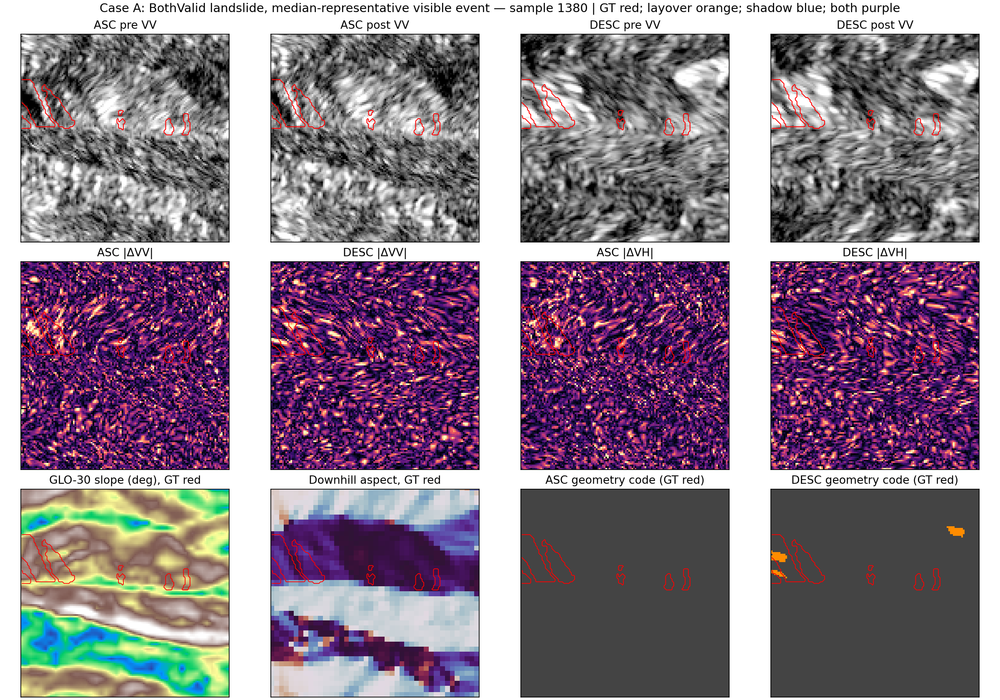
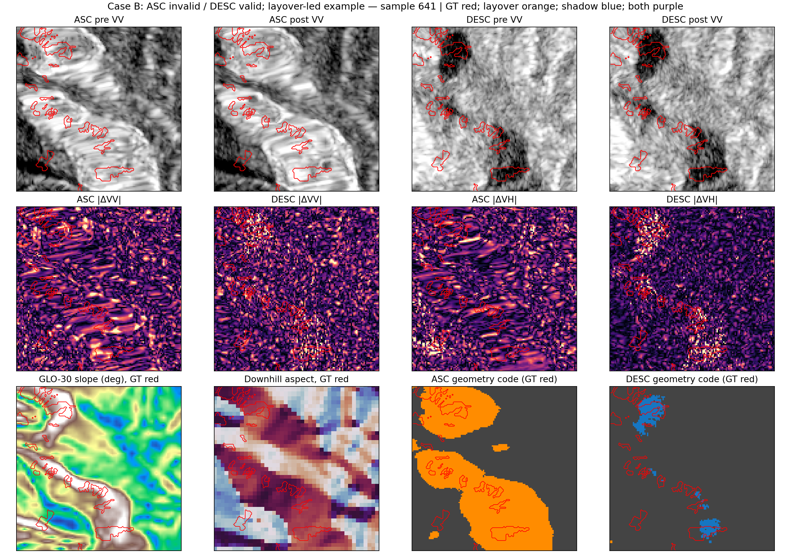
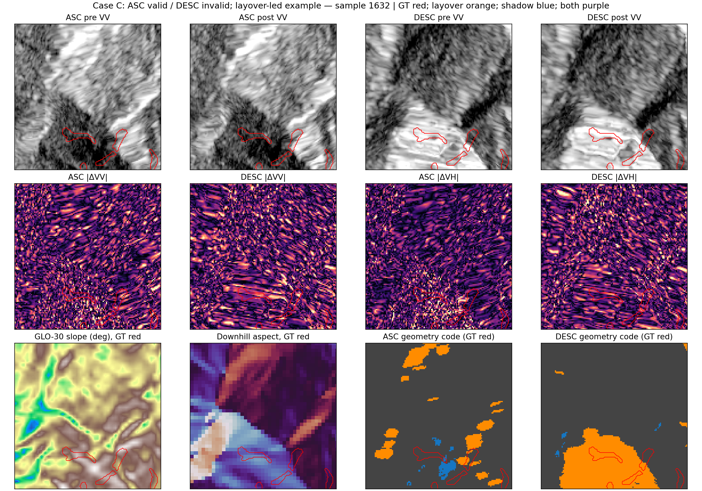
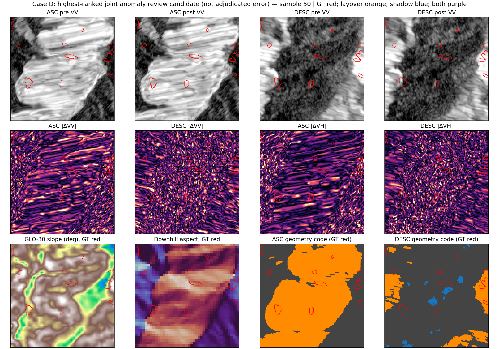

# Haiti COCD 数据集取证审计

审计日期：2026-09-27。只检查本地数据、元数据与派生统计；没有重新划分数据、修改训练协议或用网络结果改变审计阈值。计数单位除特别注明外为 1,713 个 128×128 patch-pixel；滑窗重叠，因此不是独立地理像元。

## 摘要裁决

| 审计项 | 评级 | 主要依据 |
|---|---|---|
| Landslide annotation quality | **PASS WITH LIMITATIONS** | BothValid 中 ASC/DESC 的绝对 SAR 变化和地形匹配对照均有正向差异；但本地没有原始 polygon、来源 feature ID 或 optical 文件，且 label provenance / event timing 无法逐面核验。 |
| Geometry mask physical validity | **PASS WITH LIMITATIONS** | code 值、ASC/DESC 互补和随坡度/坡向变化均符合侧视 SAR 几何预期；但生成脚本、确切轨道/视向/入射角输入不在本地。 |
| ASC/DESC registration quality | **PASS WITH LIMITATIONS** | 1,713 个样本的 shape、CRS、transform、pre/post geometry 像元全部一致；±3 px 平移敏感性存在，不能据共网格证明绝对物理配准精度。 |
| Temporal consistency | **PASS WITH LIMITATIONS** | acquisition 日期可确认，但数据窗口跨越 8 月 14 日地震和 Grace；缺少 ASC 8 月 17 日成像时刻及逐 polygon 日期/影像来源。 |
| Suitability for single-orbit SAR landslide research | **PASS WITH LIMITATIONS** | BothValid 中标签区与背景存在中等但一致的变化幅度差异；样本为滑坡富集 patch，不代表整个灾区随机分布，也不能由此单独证明因果。 |
| Suitability for geometry-invalid region evaluation | **FAIL as primary orbit-observability evaluation** | invalid 区物理 GT 可以保留，但该轨 SAR 不宜被要求在无可靠观测处承担常规可观测性分割分数；只宜另列诊断。 |

**建议处理：保留 physical GT；对对应 orbit 的 geometry code>0 像元，在 loss 与主评价中 ignore，并在产品层标记 unreliable；G10/G01 和 invalid 区只作分层诊断。不要把 invalid GT 改写为负类，也不必全局删除。**

## B1. 文件、波段与网格审计

| 本地内容 | 物理文件 | 核查结果 |
|---|---:|---|
| ASC pre `20210805` | 1,713 GeoTIFF | 每幅 3-band float32，128×128，EPSG:4326；transform 与对应样本其余影像一致。 |
| DESC pre `20210803` | 1,713 GeoTIFF | 同上。 |
| ASC post `20210817` | 1,713 GeoTIFF | 同上。 |
| DESC post `20210815` | 1,713 GeoTIFF | 同上。 |
| processed | 5,139 GeoTIFF | 每位置 GT + ASC/DESC geometry mask 共 3 个文件。 |
| Sentinel-2 pre/post | **0 / 0** | 元数据有绝对路径引用，但引用路径不在本机；相应本地影像目录不存在。未伪造 optical 检查。 |
| DEM | 两块本地 tile | `N18W075.tif`、`N18W074.tif`；各 3600×3600 float32、EPSG:4326、约 1 arc-second；比名义 10 m SAR 网格粗。 |
| 原始 polygon / shapefile | **0** | 数据根目录没有 `.shp/.gpkg/.geojson/.kml`。 |

全 1,713 样本比对结果：shape mismatch=0、CRS mismatch=0、transform mismatch=0、非有限像素=0；ASC/DESC 各自 pre/post geometry 像元不一致数=0；processed mask 与原始 SAR band-3 mask 不一致位置=0；geometry code 越界值=0。示例 SAR GeoTIFF 的 band description 为空、nodata 未设置；因此 VV/VH 通道含义依赖处理元数据/代码约定，不是 GeoTIFF 自带的 band label。像元角分辨率为约 `0.0000898315°`，地理坐标网格；元数据记名义 10 m。

本地 `metadata.json` 将 geometry 编码写为 `0 valid, 1 layover, 2 shadow, 3 layover+shadow`；全量观察到的 ASC/DESC geometry unique codes 均为 `{0,1,2,3}`。Landslide raster 全量观察到 `{0,1,2,3}`；sidecar 语义写为 `0 non-landslide; 1/2/3 landslide` 并标注 NASA inventory raster，因此所有统计都按 `GT > 0` 定义正类，但 code 1/2/3 的内部差异语义未知。这个 sidecar 不能代替原始 polygon / provenance archive 的核验。

## B2. Geometry mask 代码、自洽和互补性

| Orbit | code 0 valid | code 1 layover | code 2 shadow | code 3 两者 | invalid 合计 |
|---|---:|---:|---:|---:|---:|
| ASC | 86.2479% | 13.6811% | 0.0544% | 0.0166% | 13.7521% |
| DESC | 94.0236% | 5.3270% | 0.6381% | 0.0113% | 5.9764% |

二元联合比例（行=ASC invalid?，列=DESC invalid?）：

| | DESC valid | DESC invalid |
|---|---:|---:|
| ASC valid | **81.0488%** | **5.1992%** |
| ASC invalid | **12.9748%** | **0.7773%** |

因此仅一轨有效的组合占 18.17%，且 ASC-invalid/DESC-valid 明显多于反向组合，和两轨失效区域并不相同这一点相符。它证明的是 mask 的空间互补，不单独证明每个 invalid 标签都正确。

## B3. DEM 坡度/坡向物理一致性

使用本地 DEM 计算坡度、下坡 aspect 并采样到 patch grid；由于 DEM 约 30 m、SAR 名义 10 m，此处只作地形一致性审查。按坡度的 geometry invalid 比例及 `P(GT|invalid) / P(GT|valid)` 比值为：

| Slope | ASC invalid | DESC invalid | ASC GT 风险比 | DESC GT 风险比 |
|---|---:|---:|---:|---:|
| 0–10° | 1.10% | 0.19% | 15.98 | 26.33 |
| 10–20° | 3.15% | 0.58% | 5.65 | 7.21 |
| 20–30° | 9.00% | 2.00% | 2.17 | 3.21 |
| 30–40° | 21.78% | 9.45% | 1.15 | 1.52 |
| >40° | 32.54% | 20.70% | 1.05 | 1.00 |

失效概率随坡度增大；陡坡段 invalid 与 valid 的 GT 风险接近。但低坡 invalid 支持量很小，条件风险比不稳定；而且风险比在低坡仍偏大，现有结果**不能**说 overlap 主要由 slope 完全解释。

按同一坡度 bin 拆分 mask class occurrence（百分比）：

| Slope | ASC layover | ASC shadow | ASC both | DESC layover | DESC shadow | DESC both |
|---|---:|---:|---:|---:|---:|---:|
| 0–10° | 1.10 | 0.00 | 0.003 | 0.17 | 0.02 | 0.002 |
| 10–20° | 3.15 | 0.0004 | 0.004 | 0.52 | 0.06 | 0.007 |
| 20–30° | 8.99 | 0.007 | 0.005 | 1.85 | 0.15 | 0.008 |
| 30–40° | 21.71 | 0.04 | 0.024 | 8.91 | 0.53 | 0.011 |
| >40° | 32.14 | 0.34 | 0.060 | 16.95 | 3.71 | 0.035 |

按八方向 aspect 的 layover/shadow occurrence（百分比）：

| Downhill aspect | ASC L/S | DESC L/S |
|---|---:|---:|
| N | 3.11 / 0.01 | 0.44 / 0.30 |
| NE | 0.97 / 0.09 | 4.94 / 0.03 |
| E | 0.77 / 0.26 | 21.33 / 0.01 |
| SE | 1.39 / 0.10 | 16.32 / 0.01 |
| S | 8.42 / 0.01 | 1.71 / 0.03 |
| SW | 36.50 / 0.00 | 0.15 / 0.48 |
| W | 46.57 / 0.00 | 0.08 / 2.92 |
| NW | 22.13 / 0.00 | 0.14 / 2.27 |

最强 layover 方向在两轨互换：ASC 西/西南，DESC 东/东南；DESC shadow 主要在西/西北，而 ASC 这些坡向的 shadow 接近 0。两轨主方向互换符合相反观测方位下 mask 随 aspect 改变的定性趋势；但缺 heading/look azimuth，不能把 compass sector 严格指认为具体“面向雷达/背向雷达”坡面。平地（slope<3°）ASC invalid=0.22%、DESC=0.02%。侧视雷达的 layover/shadow 受坡度与 look angle 共同控制。[NASA SAR Handbook 对 sensor-facing slope、layover 和 shadow 的定义](https://earthdata.nasa.gov/s3fs-public/2025-04/SARHB_CH2_Content.pdf)

不过本地没有 Sentinel-1 scene ID、relative orbit、heading、精确 look azimuth/incidence angle，也没有 geometry mask 的原始生成代码。因而这里只能给出“定性物理一致”，不能做逐像元射线几何复算或确认 mask 上游没有异常。

## B4–B5. GT 地形分布与 GT × mask

| Slope | P(GT=1\|slope) | GT 正像元占全部 GT |
|---|---:|---:|
| 0–10° | 0.240% | 0.287% |
| 10–20° | 0.922% | 2.915% |
| 20–30° | 2.656% | 11.333% |
| 30–40° | 9.196% | 42.722% |
| >40° | 25.359% | 42.743% |

坡度 <3° 的 GT 仅约 **0.0037%**。按 patch 等权，GT 平均坡度为 35.94°、平均高程约 755.9 m。GT 主要落在有坡地形，不像大规模平地标签；但没有本地 optical / 水体 / 道路矢量，不能据地形单独排除道路或城镇混淆。

| Orbit | P(invalid\|GT) | P(invalid\|BG) | P(GT\|invalid) | P(GT\|valid) | GT-invalid IoU / Dice | OR / RR |
|---|---:|---:|---:|---:|---:|---:|
| ASC | 27.250% | 12.785% | 13.248% | 5.639% | 0.0979 / 0.1783 | 2.555 / 2.131 |
| DESC | 15.559% | 5.290% | 17.406% | 6.004% | 0.0895 / 0.1643 | 3.299 / 2.941 |

GT 和 invalid mask 有关联，但 IoU 约 0.09–0.10，远未等价。按坡度分层，RR 从 >40° 的 ASC 1.05 / DESC 1.00 上升到低坡区；其中低坡 invalid pixels 很稀少。结论为**terrain confounding 存在，但“主要由它解释”仍不确定**：DEM 尺度较粗、patch 高度富集 GT、空间重复与低坡 invalid 的稀疏支持均限制解释。

## B6–B8. BothValid SAR 变化与跨轨一致性

仅统计 target 与 counter geometry 均 code=0 的位置。下面的“patch-paired difference”是每个 patch 的 GT−背景均值再做 patch 级配对；CI 为 patch bootstrap、检验为 Wilcoxon。样本窗口有地理重叠，patch bootstrap 不能完全消除共地重复，所以不把 p 值解释为总体独立样本显著性。

| Orbit / measure | GT pooled mean | BG pooled mean | patch-paired GT−BG (95% CI) | Wilcoxon p |
|---|---:|---:|---:|---:|
| ASC signed ΔVV | +0.774 | +0.757 | −0.022 [−0.054, +0.010] | 0.0878 |
| ASC abs ΔVV | 2.462 | 2.266 | +0.118 [0.102, 0.135] | 9.71e−55 |
| ASC signed ΔVH | +0.562 | +0.911 | −0.243 [−0.279, −0.207] | 6.53e−40 |
| ASC abs ΔVH | 2.802 | 2.573 | +0.172 [0.148, 0.195] | 4.20e−62 |
| ASC joint absolute change | 4.146 | 3.808 | +0.234 [0.209, 0.260] | 4.72e−89 |
| ASC VV/VH texture change | — | — | +0.019 / +0.085 | 9.74e−09 / 6.08e−70 |
| ASC VV/VH local contrast change | — | — | +0.107 / +0.452 | 5.03e−29 / 8.41e−82 |
| DESC signed ΔVV | −0.117 | −0.142 | −0.057 [−0.088, −0.027] | 2.05e−09 |
| DESC abs ΔVV | 2.339 | 2.111 | +0.151 [0.136, 0.167] | 2.27e−97 |
| DESC signed ΔVH | −0.566 | −0.160 | −0.299 [−0.331, −0.266] | 1.86e−71 |
| DESC abs ΔVH | 2.592 | 2.319 | +0.154 [0.133, 0.173] | 1.33e−67 |
| DESC joint absolute change | 3.874 | 3.487 | +0.236 [0.212, 0.260] | 3.30e−109 |
| DESC VV/VH texture change | — | — | +0.055 / +0.072 | 2.32e−91 / 3.30e−80 |
| DESC VV/VH local contrast change | — | — | +0.171 / +0.280 | 2.40e−77 / 2.58e−60 |

变化尺度为本地数据的 dB-like channel scale；signed change 并不要求同号。BothValid GT=1 有 1,126,750 patch-pixels、背景 21,620,235 patch-pixels。幅值/texture/contrast 的区分为正，但幅度不大，不能把 SAR change 单独当作逐 polygon 的真值验证。

地形匹配在 patch 内按 5 档坡度 × 8 档坡向（另有 flat 档）× 高程区间匹配 BothValid 正像元与背景；匹配覆盖率按 GT 像元合并约 **99.60%**，按 patch 求平均约 **97.02%**。匹配后：

| BothValid matched GT−BG | ASC mean [95% CI] | DESC mean [95% CI] | dz ASC / DESC | paired Wilcoxon p ASC / DESC |
|---|---:|---:|---:|---:|
| abs ΔVV | +0.095 [0.080, 0.111] | +0.120 [0.105, 0.134] | 0.288 / 0.402 | 7.53e−43 / 1.03e−68 |
| abs ΔVH | +0.105 [0.088, 0.123] | +0.140 [0.123, 0.156] | 0.288 / 0.409 | 1.15e−30 / 6.17e−70 |
| joint absolute change | +0.161 [0.141, 0.181] | +0.203 [0.184, 0.221] | 0.376 / 0.527 | 1.54e−56 / 1.41e−98 |
| VV texture change | +0.027 [0.022, 0.032] | +0.037 [0.032, 0.043] | 0.248 / 0.330 | 3.10e−28 / 5.26e−56 |
| VV local contrast change | +0.093 [0.076, 0.111] | +0.137 [0.119, 0.155] | 0.250 / 0.361 | 1.67e−28 / 2.32e−57 |

对应的 patch-paired Cohen dz 范围 ASC **0.248–0.376**、DESC **0.330–0.527**。对上述五类指标的 patch-paired Wilcoxon p 值范围分别 ASC `1.67e−28` 至 `1.54e−56`、DESC `1.03e−68` 至 `1.41e−98`；10,000 次 sign-flip permutation 的 p 都达到 Monte Carlo floor `1.0e−4`。CI、effect size 和检验均基于 patch-paired summaries；相邻 patch 地理重叠会降低独立性，不能把极小 p 当作人口级确定性。匹配控制坡度、坡向、高程和 BothValid，但不能控制地表覆盖、地质、配准和事件来源。它支持“GT 区内存在额外 SAR change 证据”，并不证明每个 GT 都是这两幅影像间新发生的滑坡。

额外计算了一个只用于 anomaly screening 的 GT 栅格边界—变化共定位代理：将 `GT minus 3×3 erosion` 作为一像元内边界，在 BothValid 区比较两轨平均 `hypot(|ΔVV|,|ΔVH|)`。有 1,671 个 patch 同时具备可用边界与背景；边界减背景平均 +0.188（本地变化尺度），边界/背景均值比 1.054，78.46% patch 的边界 change 高于 BothValid 背景。这个差异较小、没有地形匹配，也依赖 rasterized GT 边界；**它不是 polygon edge distance、optical validation 或 coregistration proof**。逐 patch 数值已并入 `dataset_patch_audit.csv` 和 `anomaly_topk.csv`，完整边界表为 `gt_boundary_change_alignment.csv`。

跨轨同一 GT patch 的变化幅度相关很弱：GT |ΔVV| Pearson/Spearman r=0.038/0.091，|ΔVH| −0.006/−0.001，joint change 0.080/0.077；GT−BG joint contrast 0.160/0.108。只有 **54.64%** patch 在两轨都满足 GT change > matched background（95% 区间 52.31–57.09%）。因此两轨各自的总体 GT-vs-background 差异较稳定，但逐 patch 的跨轨排序/证据并不强一致。

## B9. G10 / G01 可观测性诊断

| Region | GT positive pixels | valid-view joint change magnitude 赢过 invalid-view 的像素比例 | patch paired valid−invalid mean [95% CI] |
|---|---:|---:|---:|
| G10：ASC invalid / DESC valid | 457,707 | 57.31% | +0.606 [0.526, 0.688] |
| G01：ASC valid / DESC invalid | 238,335 | 58.48% | +0.771 [0.685, 0.857] |

两组中有效轨更经常有较大 joint change，但比例约 57–58%，并非压倒性区分。它支持 geometry mask 表示“可信观测性”的方向性，不代表 invalid 轨没有任何变化，更不能把那些变化当成可解释地表信号。

## B10–B11. 时间错配与配准敏感性

本地日期为 ASC pre 8/5、DESC pre 8/3、DESC post 8/15、ASC post 8/17；sidecar 还引用 S2 pre 8/4、post 8/14，但影像文件缺失。USGS 记录 Mw 7.2 地震发生在 2021-08-14 12:29 UTC；NHC 报告 Grace 在 8 月 17 日清晨从 Tiburon 半岛近海通过。[USGS](https://www.usgs.gov/news/featured-story/magnitude-72-earthquake-haiti?sf149078350=1)；[NHC Tropical Storm Grace report](https://www.nhc.noaa.gov/data/tcr/AL072021_Grace.pdf)。ASC 8/17 acquisition 与 Grace 降雨时间关系尤其无法由“日期”单独判断；DESC 8/15 在地震后，S2 post 与地震同为 8/14 日期但缺 acquisition time，不能断定先后。没有每个 polygon 的来源影像和事件日期，不能分配地震/Grace 成因。

为筛查而非判错，定义一个 BothValid 对 GT/BG |ΔVV| ratio 的代理：GT fraction≥2%、有 BothValid GT，且一轨 ratio≥1.20、另一轨≤1.05、两轨 ratio≥1.5。满足者为 **13/1,055=1.23%**：ASC-only 2 个（24、50），DESC-only 11 个。此粗阈值只表示 orbit/time response discordance；不是 polygon temporal mismatch 率，更不是错标率。修订后的前 10 项在 `anomaly_topk.csv` Type5。

像元网格一致性检查没有发现文件级 shift：shape/CRS/transform 全部一致，pre/post geometry mask 逐像元相同。另对 GT 在固定原始 BothValid mask 内做 ±3 px 的 49 个离散平移敏感性检查（边缘裁切、不环绕）：零位移 ASC |ΔVV| GT−BG 均值 +0.1185 [0.1017, 0.1355]；49 格中 post-hoc 最佳为 dy=−1、dx=+2，均值 +0.1541 [0.1334, 0.1747]。这提示 association 对平移有一定敏感性，但最佳值是扫描后选择，未做多重比较校正，CI 有轻微重叠；不能据此声称找到真实偏移或证明严重错配。缺 optical 与 source vectors 使边界配准无法外部核对。

## B12–B14. 选择偏差、异常候选和可视案例

GT fraction 分布（每 patch）：mean 6.69%、median 3.07%、min 0.55%、max 48.86%；1,700/1,713 patch 有 >100 个 positive pixels。当前 transfer 没有 patch 生成/筛选脚本，所以这只是经验富集证据，不能据此声称确切的原始 patch 选择阈值。GT 平均坡度按 patch 等权为 35.94°。这说明样本明显 landslide-enriched，不是整片灾区的随机像元样本，不能将这些 patch 内 prevalence 外推为灾区发生率。相邻滑窗共享地理像元，也使 patch 数和像元数不能视作独立空间样本。

`anomaly_topk.csv` 各含最多 10 个确定性排序候选：Type1 为 GT 较多、BothValid 覆盖较高但两轨事件 contrast 最弱；Type2 为 GT 与双轨 invalid overlap 极端；Type3 为 GT 低坡比例最高；Type4 为 mask 与 DEM slope 关系最不一致；Type5 为上面的 GT≥2% temporal/orbit proxy。每行均附 patch 的 mean slope、ASC/DESC invalid ratio、GT-mask overlap、BothValid GT 的 per-orbit |ΔVV|/|ΔVH|、matched-background contrast、cross-orbit disagreement 及 GT 栅格边界 change 共定位字段，便于并排复核。它们是人工复核候选，不能自动判为错误。Case D 选取全局复合异常分数最高 patch 50，标签为“未裁决异常候选”。

案例按 `case_selection_log.json` 中预先记录的规则选择：A=1380（BothValid、GT 较丰富且代表性变化）、B=641（ASC invalid/DESC valid、layover 主导）、C=1632（ASC valid/DESC invalid、layover 主导）、D=50（复合异常评分最高）。图片含 ASC/DESC pre/post VV、绝对 ΔVV/ΔVH、GLO-30 slope、downhill aspect、geometry code 和 GT 轮廓；本地没有 S2 图像，故不含 optical panels。

## B15–B16. 最终问题回答

1. **GT 是否有真实 pre/post event evidence 支撑？** 有限度地有：BothValid 两轨以及地形匹配后，GT 区域绝对变化/texture/contrast 均高于背景；但这是总体统计支撑，不是 polygon 来源或因果真值确认。
2. **mask 是否符合 slope/aspect SAR physics？** 总体符合：invalid 比例随坡度上升，ASC 西/西南 layover 与 DESC 东/东南 layover 方向互补；因缺 look geometry 与上游代码，评级仍为 with limitations。
3. **两轨 distortion region 是否互补？** 是：单轨 invalid 区分别约 12.97% 与 5.20%，两轨同时 invalid 仅 0.78%。
4. **geometry 与 GT 关联主要由 terrain 解释吗？** **UNCLEAR**。陡坡 strata 的 RR 接近 1，但低坡 RR 偏高且 invalid 支持很薄；粗 DEM 和富集 patch 也限制因果分解。
5. **有无大规模错标、配准偏差、时间错配证据？** 没有发现文件级大规模 grid mismatch；有少量时间/跨轨响应 discordance 候选（13/1,055）及平移敏感性信号，但都不足以证明错标或固定偏移。per-polygon 来源缺失是主要未决项。
6. **invalid GT 怎么处理？** 保留 physical GT；对应 orbit 的 loss 和主分数中 ignore，产品标 unreliable；invalid-zone 分数单列诊断，不当作常规可观测区 KPI。
7. **足以作为 GRSL 实验数据集吗？** **有条件足够**支撑严谨的单轨/双轨方法比较与明确限定范围的案例研究；不够支撑无保留的灾区普适性、全 polygon 因果事件确认或 geometry-invalid 区 SAR 可观测性声明。
8. **论文需披露的限制：** NASA TODO sidecar 声明与源 polygon 的 byte/feature 级对应尚未证明；原始 polygons / feature IDs / rasterization 参数缺失；S2 与 optical pre/post 源图本地缺失；mask 生成代码和 scene/orbit/look 参数缺失；DEM 比 SAR 粗约 3 倍；日期窗口覆盖地震与 Grace、无 per-polygon attribution；patch landslide-enriched 且窗口重叠；geometry-invalid 区只能标 unreliable；单 Haiti 多时相切片不能代表灾区总体。

### 可复现产物

- 全 patch 表：`dataset_patch_audit.csv`
- 栅格边界/变化共定位代理：`gt_boundary_change_alignment.csv`
- 汇总、联合分布、区间和筛查统计：`audit_summary.json`
- 五类 top-k：`anomaly_topk.csv`
- Case 选择规则：`case_selection_log.json`
- 49 偏移敏感性表：`registration_shift_sensitivity.csv`
- 分析代码：`run_extended_audit.py`；修正 Type5 eligibility 后的派生文件更新器：`finalize_audit_artifacts.py`
