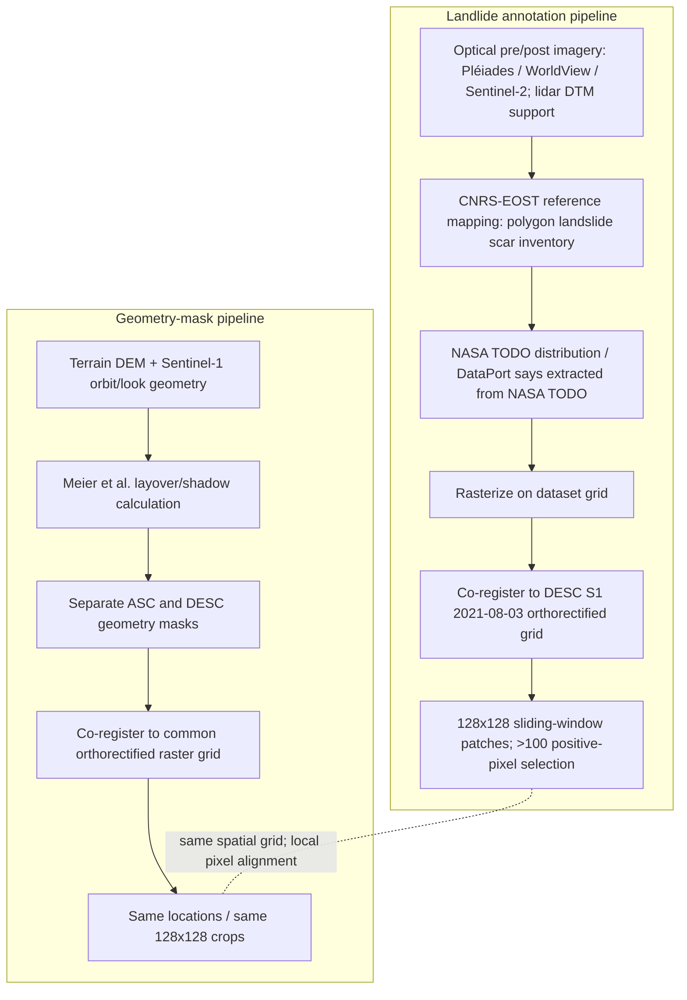

# Haiti COCD dataset provenance and geometry audit

Audit date: 2026-09-24. No model training. Pixel statistics use all 1,713 local 128x128 patches (28,065,792 patch-pixels; note that 64-pixel sliding-window stride means neighboring patches overlap and pixels are not independent observations).

## Dataset timeline and source chain

| Date | Evidence / event |
|---|---|
| 2021-08-03 | DESC Sentinel-1 pre |
| 2021-08-04 | Sentinel-2 pre |
| 2021-08-05 | ASC Sentinel-1 pre |
| 2021-08-14 | Mw 7.2 Nippes earthquake; Sentinel-2 post acquisition is also dated Aug 14 |
| 2021-08-15 | DESC Sentinel-1 post (before Grace) |
| 2021-08-17 | Tropical Storm Grace affected Haiti; ASC Sentinel-1 post has this calendar date (the local metadata does not provide acquisition time relative to rainfall) |
| 2021-08-23 | Pléiades image acquired over central Pic Macaya, cited as input in the later reference-inventory work |
| 2021-09 onward | CNRS-EOST released rapid ALADIM products; the later reference manual inventory was prepared within months and used multiple optical sources |
| 2024-07-14 | Haiti multimodal dataset posted to IEEE DataPort; its page says annotations were extracted from NASA TODO, rasterized, and cropped |

Sources: Bralet thesis, Chapter 5 §5.2, printed pp.111–112; Amatya et al. (2023), §§1.1, 2.1, 3.3.1; local `data/haiti/processed/sample_000000/metadata.json`.

## Provenance tables

| Item | Established provenance | Not established from available artifacts |
|---|---|---|
| Landslide GT | Thesis says the 14,482-polygon inventory was provided through NASA; DataPort says labels are extracted from NASA TODO. The 2023 Haiti response paper independently documents a 14,482-polygon, 45 km² CNRS-EOST reference inventory, manually mapped from Pléiades, WorldView and Sentinel-2, supported by a 2016 lidar DTM. Its cues include pre/post radiometric/land-use change, vegetation density, bare soil, scarps, cracks and surface disturbance; interpretation considered slopes >10°. | Exact equality between the DataPort/NASA TODO source object and the cited CNRS-EOST inventory is **not proven** by count alone. The original annotation archive/polygon file is not in this local transfer, so no source feature IDs, CRS, extent, rasterize parameters, pixel agreement, IoU, boundary error, dilation/erosion or polygon-cleaning audit can be reported. The local masks only encode 0 background and 1/2/3 positive inventory classes; meanings among positive values are not documented locally. The external inventory paper calls its reference inventory manually mapped; this is distinct from the separate automated ALADIM release and from the USGS 4,893 initiation-point inventory. |
| Geometry masks | DataPort description and thesis §5.2 state layover/shadow masks are computed using Meier et al. (1993); the thesis says they are supplied separately for ASC and DESC. Local metadata explicitly codes 0 valid, 1 layover, 2 shadow, 3 both. All 1,713 raw stack band-3 masks match the processed per-orbit mask; pre/post band-3 masks match pixel-for-pixel in both tracks. | Local mask-generation program/log and its exact DEM/orbit inputs are absent. The thesis documents SRTM 1-arcsecond for SAR orthorectification, but does not, in the accessible passage, explicitly prove the mask computation used that exact DEM. The description strongly supports a terrain-plus-acquisition-geometry mask independent of GT; absence of source code prevents proving a negative about every upstream manual step. |

### Provenance diagram

The two semantic-generation branches are described independently in the dataset/thesis; they meet at raster georeferencing and crop extraction. Since the upstream mask generator and raw annotation archive are absent, this is documented pipeline independence, not byte-level proof that the upstream workflows never exchanged any ancillary file.

## Geometry code and full-data overlap

Local value verification: code set is {0,1,2,3}, with semantics above; the processed masks exactly equal the mask band in raw stacks. This is directly checked against all 1,713 patches for mask-file equality and pre/post equality. Counts below are patch-pixel counts, not unique ground pixels because the patch windows overlap.

| Track | Valid 0 | Layover 1 | Shadow 2 | Both 3 | Invalid total |
|---|---:|---:|---:|---:|---:|
| ASC | 86.2479% | 13.6811% | 0.0544% | 0.0166% | 13.7521% |
| DESC | 94.0236% | 5.3270% | 0.6381% | 0.0113% | 5.9764% |

| Statistic | ASC invalid (code>0) | DESC invalid (code>0) |
|---|---:|---:|
| P(invalid \| GT=1) | 0.27250 | 0.15559 |
| P(invalid \| GT=0) | 0.12785 | 0.05290 |
| P(GT=1 \| invalid) | 0.13248 | 0.17406 |
| P(GT=1 \| valid) | 0.05639 | 0.06004 |
| GT–invalid IoU / Dice | 0.09787 / 0.17828 | 0.08951 / 0.16431 |
| Odds ratio / relative risk | 2.555 / 2.131 | 3.299 / 2.941 |

By class, P(GT=1 | layover/shadow/both) is ASC 0.13185/0.26059/0.23317 and DESC 0.16535/0.24752/0.12961. Shadow and both classes are much smaller than layover. Overall, 72.75% of positive patch-pixels are ASC-valid and 84.44% are DESC-valid. Thus there is genuine association, but the masks are far from equivalent to GT (IoU about 0.09–0.10).

### Slope stratification and patch-selection caveat

Copernicus GLO-30 was downloaded for the area; slope was estimated from the 30 m DEM and nearest-sampled onto local patch pixels. Conditional invalid-vs-valid GT risk ratios by slope bin are:

| Slope | ASC RR | DESC RR | Invalid-pixel fraction ASC / DESC |
|---|---:|---:|---:|
| 0–10° | 10.74 | 12.84 | 1.89% / 0.35% |
| 10–20° | 4.88 | 6.24 | 3.67% / 0.69% |
| 20–30° | 2.47 | 3.60 | 8.88% / 2.12% |
| 30–40° | 1.21 | 1.62 | 20.77% / 8.89% |
| >40° | 1.05 | 1.04 | 31.94% / 19.74% |

This is **not** evidence that slope completely explains the overlap: association approaches 1 in the steepest bin but remains large in low-slope bins, where the invalid class has small support. The 30 m DEM is coarser than the nominal 10 m SAR grid; pixel samples are spatially dependent and repeated across overlapping patches. A patch-clustered model/matched-site analysis using a higher-resolution terrain surface is needed before saying the overlap is “mainly” slope-driven. Also, all 1,713 patches were selected around landslides; local raster count shows 1,700/1,713 have >100 positive pixels. Consequently these are conditional patch statistics, not an unbiased whole-landscape prevalence estimate. This qualification corrects the earlier audit report's overconfident “slope completely explains” wording.

## Temporal consistency and label meaning

The GT raster is one static inventory mask used against both orbit pairs. DESC post (Aug 15) and Sentinel-2 post (Aug 14) predate Grace's Aug 17 impacts; ASC post is dated Aug 17 but local files lack acquisition time-of-day. The reference inventory was mapped after the events using imagery that included Pléiades acquired Aug 23 over central Pic Macaya; the 2023 paper explicitly treats the event sequence as earthquake plus Grace and says close timing makes their separate impacts difficult to ascertain. Therefore there is a **real potential temporal label mismatch**, especially for DESC/S2 and possibly ASC, but no local per-polygon date/source/event attribution exists to count affected labels. The article reports the 4,893 USGS inventory as point-format initiation locations; that is not the 14,482 polygon reference inventory.

The 14,482 reference polygons indicate mapped landslide footprints/scars; the cited mapping method does not provide source/transport/deposit class labels, so the raster cannot be interpreted as initiation-only or as a physically partitioned whole landslide body. Exact polygon coverage semantics need source schema / mapper instructions.

## SAR pre/post change by label and observability

I accumulated absolute VV/VH change (in the local dB-like data scale) on positive pixels inside BothValid and on background BothValid pixels, plus positive/negative pixels by target invalid class. These are descriptive pooled patch-pixel means; they are not inferential tests, and overlap between neighboring windows duplicates spatial support.

| Orbit / polarization | GT=1 & BothValid mean | GT=0 & BothValid mean | Positive minus background |
|---|---:|---:|---:|
| ASC VV mean |Δ| | 2.462 dB (n=1,126,750) | 2.266 dB (n=21,620,235) | +0.196 dB |
| ASC VH mean |Δ| | 2.802 dB | 2.573 dB | +0.230 dB |
| DESC VV mean |Δ| | 2.339 dB | 2.111 dB | +0.228 dB |
| DESC VH mean |Δ| | 2.592 dB | 2.319 dB | +0.274 dB |

The mean absolute change is modestly higher in the GT than background for both polarizations/tracks, so valid-area event signal is not identically absent; however, signed changes do not cleanly separate GT from background (ASC VV +0.774 vs +0.757 dB; DESC VV −0.117 vs −0.142 dB). Mean absolute change is only a crude scalar and cannot establish spatially localized or statistically reliable landslide detectability. No p-values are appropriate from these overlapping pixel samples.

Invalid zones are not uniformly “no change”; layover can have strong radiometric changes unrelated to a reliably interpretable ground change. For example, ASC layover VV mean |Δ| is 2.490 dB on GT pixels vs 2.420 dB on non-GT layover pixels; DESC shadow VH is 5.042 vs 4.215 dB. Such changes support caution, not reliable visibility. Shadow is sparsely populated in ASC (GT n=3,975; non-GT n=11,279) and should not be generalized. This separates the physical fact “a landslide label may exist there” from the observation question “can this orbit measure it?”

## Author mask protocol

Bralet thesis Chapter 5, printed p.115 (Table 5.1 footnote and surrounding text) states BCE loss uses annotations masked for modality constraints; the layover/shadow mask is applied to SAR-SAR annotation supervision. Metrics are reported on masked and raw/actual annotations. Printed p.116, Table 5.2 labels values “masked / actual” and lists separate SAR-SAR scores. Thus the original author explicitly separated “real mapped landslide” from “valid supervision/evaluation for this SAR observation”; geometry-invalid does not imply GT=0. Local implementation is an independent COCD line, but this historical protocol supports target-orbit loss masking and retaining the physical GT for a separate diagnostic.

## Visual sample audit

Eight contact sheets each contain 10 deterministic random patches (seed 20260924) selected from the full eligible pool; CSV/JSON records group and selected sample IDs. Panels show ASC/DESC pre/post VV, absolute VV change, GT, each orbit's geometry outlines, and slope derived from Copernicus GLO-30 and sampled onto the patch grid. Sentinel-2 files are absent from the transfer, so no optical panels are fabricated; these SAR/DEM sheets cannot independently establish that each polygon is a real, temporally new landslide.

| Sample group | Eligible patches | Contact sheet |
|---|---:|---|
| GT & BothValid | 1,646 | `visual_GT_BothValid.png` |
| GT & ASC layover | 1,258 | `visual_GT_ASC_layover.png` |
| GT & ASC shadow | 238 | `visual_GT_ASC_shadow.png` |
| Background & ASC layover | 1,527 | `visual_BG_ASC_layover.png` |
| Background & ASC shadow | 302 | `visual_BG_ASC_shadow.png` |
| ASC invalid / DESC valid | 1,246 | `visual_ASCbad_DESCvalid.png` |
| ASC valid / DESC invalid | 767 | `visual_ASCvalid_DESCbad.png` |
| BothValid | 1,713 | `visual_BothValid.png` |

The categories are not mutually exclusive (e.g., GT&BothValid is also BothValid). ASC-shadow GT pool exists but is much smaller at the pixel level; each selected patch needed at least one such pixel. See `visual_sample_manifest.json` for IDs and exact pool counts.

## Six decisions

| Question | Decision | Evidence and boundary |
|---|---|---|
| Q1. GT is from a real inventory, not generated from this COCD SAR change or geometry mask? | **YES (with provenance caveat)** | DataPort says NASA TODO extraction; thesis calls the 14,482-polygon NASA-provided inventory; the matching-count/area CNRS-EOST reference is mapped from pre/post optical imagery with DTM support. No evidence that this annotation workflow used this COCD geometry mask or SAR change. Exact source-object/raster equality remains unverified without archive. |
| Q2. Geometry mask is independently generated from terrain and SAR acquisition geometry? | **YES, as documented** | DataPort/thesis describe Meier et al. geometry masks; local per-track masks have standard four classes and are static pre/post. Source generation code/DEM metadata are absent, so pipeline-level independence is supported, not source-code-proven. |
| Q3. Visual overlap is mainly explained by steep-slope common cause? | **UNCLEAR** | Moderate pooled association, low IoU and slope RR→1 at >40° support a topographic relation there, but strong RR remains below 20°. Current coarse DEM, patch selection, overlapping windows and pixel dependence prevent the claim that slope mainly explains it. |
| Q4. Evidence of manual/algorithmic label mixing between GT and geometry mask? | **NO evidence found** | The documented branches are distinct and masks are static. Missing upstream scripts and polygons mean absence of coupling cannot be proven exhaustively. |
| Q5. Earthquake/Grace temporal mismatch possible? | **YES** | Mixed-event reference mapping and Aug 23 optical input postdate Aug 17 Grace; DESC post is Aug 15 and S2 post Aug 14. No per-polygon attribution means affected area/count is unknown. |
| Q6. Treat geometry-invalid GT how? | **B** | Preserve positive physical inventory for diagnostic reporting, but mask it from the loss and primary evaluation for the orbit that cannot observe it. Do not relabel it as background or delete it globally. |

## Consequence for the COCD research task

Continue masking target-orbit code>0 from segmentation loss and primary target-orbit evaluation. Use BothValid as the clean primary test of non-distortion cross-orbit transfer; TargetValid is a separate, broader deployment-valid result. Retain G10/G01 and invalid-pixel results only as observation-complementarity diagnostics. This follows the dataset's physical observability semantics and Bralet's original SAR-SAR protocol, not the preferred outcome of an existing model.

### Primary references

- Bralet, *Deep Learning for Multimodal Detection of Sudden and Slow Moving Slope Instabilities on Bitemporal Remote Sensing Images*, 2024, Chapter 5 §§5.2–5.3, printed pp.111–116, [HAL thesis record](https://hal.science/tel-05029007v1) (the local transfer excludes original annotation archive).
- Bralet et al., *Multimodal Remote Sensing Dataset for Landslide Change Detection in Haiti*, IEEE DataPort (2024), [dataset page / DOI 10.21227/4HEB-7H07](https://ieee-dataport.org/documents/multimodal-remote-sensing-dataset-landslide-change-detection-haiti).
- Amatya et al., “Learnings from rapid response efforts to remotely detect landslides triggered by the August 2021 Nippes earthquake and Tropical Storm Grace in Haiti,” *Natural Hazards* (2023), [DOI 10.1007/s11069-023-06096-6](https://link.springer.com/article/10.1007/s11069-023-06096-6), especially §§1.1, 2.1 and 3.3.1.
- Local reproducible artifacts: `audit_summary.json`, `slope_stratified.json`, `patch_slope.csv`, `case_selection.csv`, `audit_01_overlap_stats.py`, `audit_02_slope_strat.py`, `audit_03_select_and_figures.py`, `audit_04_visual_sample_sheets.py`.
